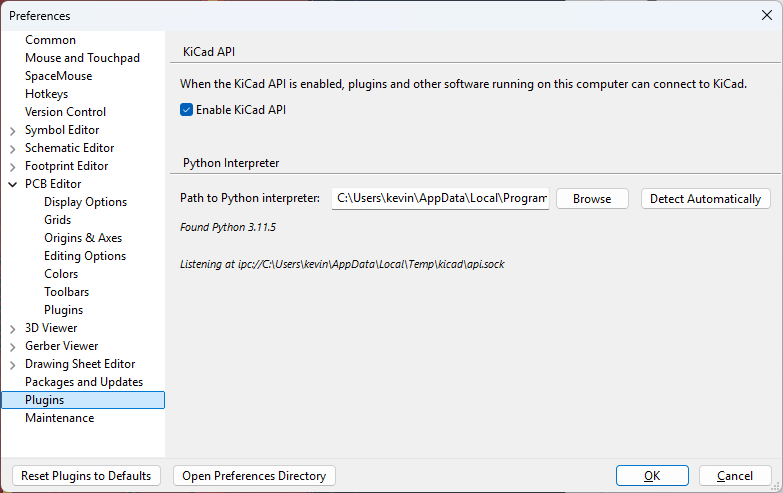
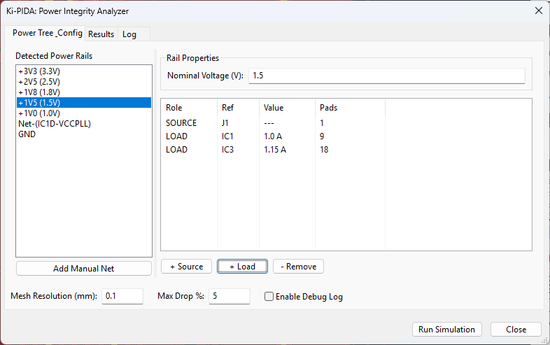
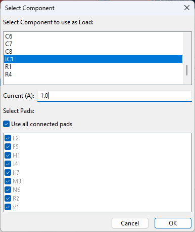
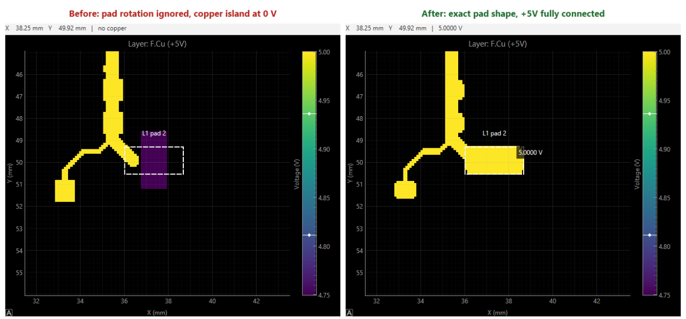
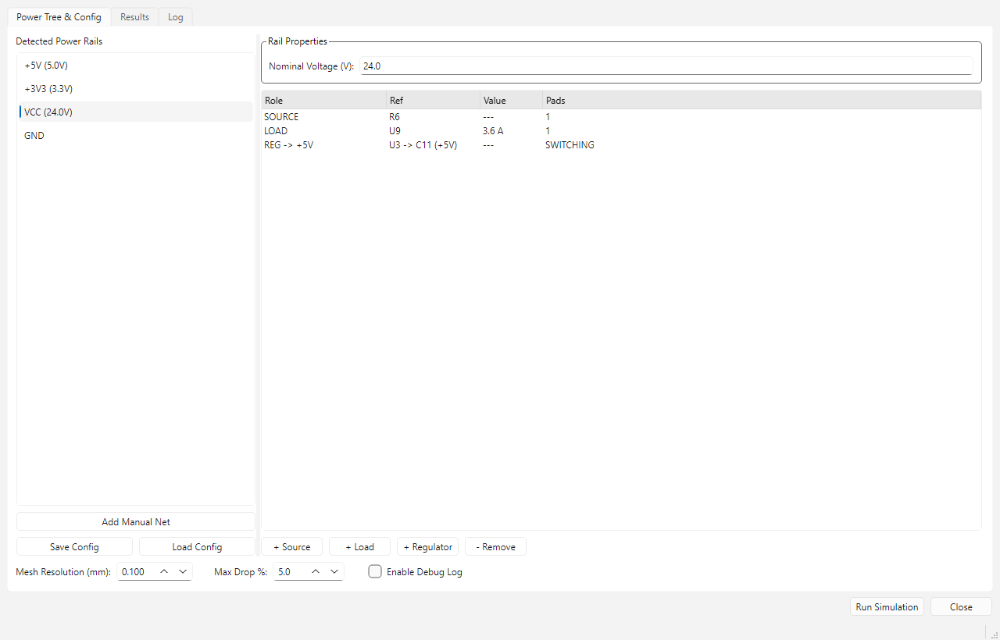
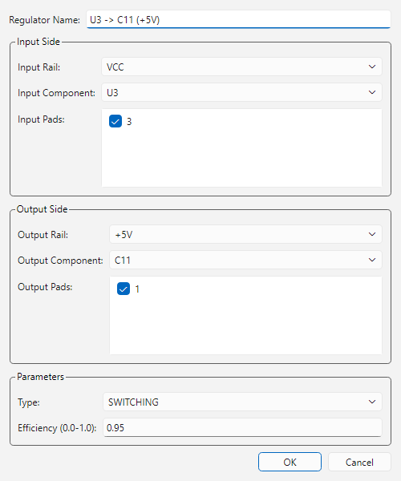
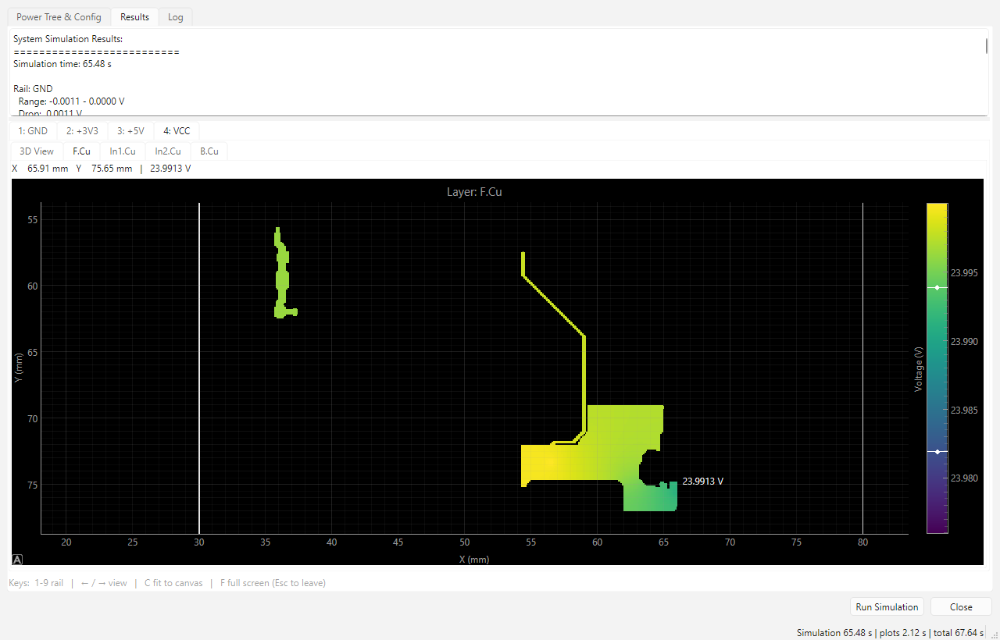
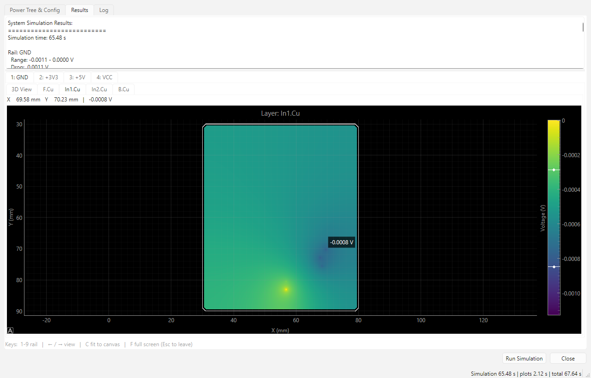
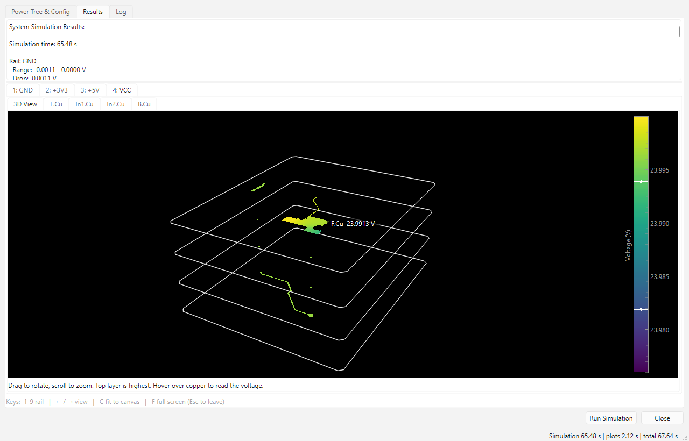

# Ki-PIDA (KiCad Power Integrity & Delivery Analyzer)

Ki-PIDA is a native KiCad plugin designed for Direct Current (DC) Power Integrity (PI) analysis. It allows PCB designers to simulate voltage drops (IR drop), current densities, and thermal rise directly within the KiCad Pcbnew environment, eliminating the need for expensive proprietary tools or complex external workflows.

## 🚀 Why Ki-PIDA?

Modern electronics operate with tight voltage margins. An IR drop of just 30mV can lead to system instability in sub-1.0V Socs. High current densities also pose thermal risks and reliability hazards like electromigration. 

Ki-PIDA democratizes high-end PI analysis by:
- **Ensuring Stability:** Detect voltage violations at the layout stage.
- **Reducing Iterations:** Identify "neck-down" regions and hotspots before prototyping.
- **Seamless Workflow:** Interactive layout-driven analysis without leaving KiCad.

## ✨ Key Features

- **Native Integration:** Built for KiCad 10 using the IPC API (`kicad-python`).
- **Power Tree Management:** Auto-discover power rails and manage complex hierarchies including VRM efficiency modeling.
- **Hybrid 2.5D Solver:** Fast and accurate simulation using an optimized resistive mesh approach.
- **Multi-Physics Support:** Coupled electro-thermal simulation to account for temperature-dependent copper resistivity.
- **Multi-Rail Analysis:** Simulate complex power trees with nested regulators (Buck, LDO) and enforce correct dependency solving.
- **Project Persistence:** Automatically saves your power tree configuration (sources, loads, regulators) in the project directory, so you don't lose your setup.
- **Visual Feedback:** Interactive heatmaps for voltage and current density, with dedicated tabs for each power rail in the system.

## 📦 Installation

Ki-PIDA targets **KiCad 10**. Follow these steps to install and enable the plugin:

### 1. Enable the KiCad API
Ki-PIDA communicates with KiCad via the IPC-based API.
1. Open KiCad.
2. Go to **Preferences** > **Plugins**.
3. Enable the API server.
4. Restart KiCad if prompted.


### 2. Install the Plugin
1. Locate your KiCad plugins directory (`${KICAD_DOCUMENTS_HOME}/10.0/plugins`):
   - **Windows:** `Documents\KiCad\10.0\plugins`
   - **Linux:** `~/.local/share/kicad/10.0/plugins`
2. Download or clone this repository.
3. Copy the repository folder into the `plugins` directory (it must contain `plugin.json` at its top level).

> [!NOTE]
> Ki-PIDA brings all of its dependencies (including its PySide6 GUI) through `requirements.txt` and does not rely on anything bundled with KiCad. It works with KiCad 10's bundled Python 3.11 or any Python 3.11+ selected in KiCad's preferences. KiCad 11 no longer bundles Python: install Python yourself (the Windows installer offers it) and select it in KiCad's preferences.

> [!NOTE]
> On first load, KiCad creates a dedicated Python virtual environment for the plugin and installs the packages listed in `requirements.txt`. The toolbar button appears only once that environment is ready. If it never appears, right-click the plugin's action in the PCB Editor preferences and choose **Recreate Plugin Environment**. The environment lives in `%LOCALAPPDATA%\KiCad\10.0\python-environments\` on Windows.

---

## 📖 Tutorial: Your First IR Drop Analysis

Follow these steps to perform a DC Power Integrity analysis on your board.

### 1. Launch the Plugin
Open your PCB layout in KiCad Pcbnew and click the **Ki-PIDA** icon in the top toolbar to open the analyzer.

### 2. Review Discovered Power Rails
- **Auto-Discovery:** Upon launch, Ki-PIDA scans your board for power rails and attempts to load any existing configuration from `kipida_config.json` in your project folder.
- **Add Roots:** Identify your main input rails (e.g., `+12V_IN`, `VBUS`).
- **Define Regulators:** Use the **+ Regulator** button to create relationships between rails (e.g., `12V -> 5V`). Ki-PIDA supports:
    - **Linear Regulators (LDOs):** Pass current 1:1 from input to output.
    - **Switching Regulators (Buck/Boost):** Conserve power based on efficiency (e.g., 90%).
    - **Multi-Output Support:** Handle PMICs where one component drives multiple output rails.



### 3. Add Sources (VRMs / Power Inputs)
Identify where power enters this net:
1. Click **+ Source**.
2. Select the source component (e.g., a regulator `U1` or connector `J1`).
3. In the dialog, check the **Pads** that are connected to the power net.
4. Click **OK**.

### 4. Add Loads (Integrated Circuits / Sinks)
Identify the components consuming power:
1. Click **+ Load**.
2. Select the sink component (e.g., MCU `U2` or FPGA `U3`).
3. Enter the **Total Current (A)** consumed by this component (e.g., `0.5` for 500mA).
4. Check the **Pads** through which the current is drawn.
5. Click **OK**.



### 5. Run the Simulation
Before running, you can adjust the **Mesh Resolution (mm)**. A value of `0.1mm` is usually sufficient for accurate results.
- Click **Run Simulation**.
- The solver analyzes the power tree topology to determine the correct solution order (Leaf-to-Root) for current propagation.
- Example: For a `12V -> 5V -> 3.3V` chain, it solves 3.3V first, applies that load to the 5V rail, solves 5V, and finally solves the 12V input.

### 6. Analyze Results
Once "Simulation Success" appears, the UI will jump to the **Results** tab.

- **Rail Selection:** A tab will be created for each power rail in your system.
- **Per-Rail Visualization:** Inside each rail's tab, you can view:
    - **3D View:** All copper layers of the net stacked in 3D. Drag to rotate, scroll to zoom. Hover to see the layer and voltage under the pointer.
    - **Layer Views:** An interactive 2D voltage map for every copper layer, in stackup order. Pan and zoom with the mouse, hover to see the voltage next to the pointer (and the coordinates above the plot), and drag the colour bar handles to adjust the scale.
    - The hover value is the solved voltage of the mesh cell under the pointer (resolution = mesh resolution), not a value read back from the colours.
- **Keyboard shortcuts** (Results tab):

  | Key | Action |
  |---|---|
  | `1` – `9` | Show rail 1–9 (tabs are numbered), keeping the same view (e.g. F.Cu) |
  | `←` / `→` | Previous / next view of the rail (3D, then each layer), wrapping around |
  | `C` | Fit the board to the canvas (2D and 3D) |
  | `F` | Toggle full screen; `Esc` also leaves full screen |
- **Board outline:** The Edge.Cuts outline is drawn on every view as a position reference, and the 2D maps open framed on the whole board.
- **Max Drop %:** Sets the colour scale range below each rail's maximum voltage. Changing it updates all plots instantly, without re-running.

> [!TIP]
> Use the **Enable Debug Log** checkbox if you encounter issues during meshing or solving to see more detail in the Log tab.

## 🛠️ Technical Overview (For Developers)

Ki-PIDA is built on a modular architecture designed for performance and maintainability.

### Project Layout
```
plugin.json            KiCad IPC plugin manifest (must stay at root)
ipc_entry.py           Entry point launched by KiCad (thin launcher)
requirements.txt       Runtime deps KiCad installs into the plugin env
pyproject.toml         Dev metadata, optional deps, pytest config
resources/             Plugin icons (24/48 px) referenced by plugin.json
tools/                 Dev scripts (make_icon.py regenerates the icons)
kipida/
  app.py               KiCad IPC connection + app bootstrap
  core/                Domain models and config persistence (pure Python)
  kicad/               Board access via kipy: net discovery, geometry extraction
  simulation/          Mesh generation, sparse DC solver, multi-rail power-tree solve
  visualization/       Result preparation for display (mesh -> per-layer grids)
  ui/                  PySide6 (Qt) main window, panels and dialogs
tests/                 pytest suite
docs/images/           README screenshots
```

### Development Setup
```
py -3.14 -m venv .venv
.venv\Scripts\python -m pip install -r requirements.txt -e .[dev]
.venv\Scripts\python -m pytest
```

### Architecture
- **Extractor (`kipida/kicad/extractor.py`):** Interfaces with the KiCad API to pull filled zone geometry, track layouts, and physical stackup data.
- **Mesher (`kipida/simulation/mesh.py`):** Discretizes continuous copper geometry into a 2D/3D resistive grid (Rasterization).
- **Solver (`kipida/simulation/solver.py`):** Uses an Admittance Matrix (Stamps method) and optimized SciPy sparse solvers (SuperLU/CG) to solve the electrical system.
- **Results view (`kipida/ui/results_view.py`):** Interactive per-layer voltage maps and a 3D layer stack, drawn with pyqtgraph (OpenGL for 3D) from per-layer grids built by `kipida/visualization/layer_grid.py`.

### Methodology
The tool utilizes a **Hybrid 2.5D Finite Difference Method (FDM)**. It represents PCB layers as 2D grids of resistors connected vertically by via/PTH resistor elements. This provides the ideal balance between the speed of a 2D solver and the accuracy of a full 3D FEM for planar PCB structures.

### Stack
- **Languages:** Python 3.11+ (KiCad 10 runs plugins on its bundled Python 3.11)
- **UI:** PySide6 (Qt 6)
- **Math:** NumPy & SciPy
- **Geometry:** Shapely

## � Current State (Alpha)

As of the current version, Ki-PIDA implements a functional end-to-end pipeline for DC IR drop analysis.

### Capabilities:
- **Comprehensive Extraction:** Extracts tracks, pads, and filled zones (respecting thermal reliefs and voids) from KiCad 9.0+ boards.
- **3D Meshing Engine:** Converts geometry into a resistive mesh across multiple layers, correctly modeling via and PTH conductances.
- **Robust Linear Solver:** Solves the circuit using SciPy's sparse matrix backend. Includes island detection to warn about floating sections of copper that could cause numerical issues.
- **Automated Diagnostics:** Detects isolated copper nodes and disjoint electrical islands during the solve phase.

### User Experience:
- **Automated Rail Discovery:** Instantly find power nets based on zone connectivity.
- **Granular Control:** Assign sources and loads down to the individual pad level.
- **In-Memory Visualization:** Instant generation of color-coded heatmaps to inspect voltage distribution without exporting files.

## �🗺️ Roadmap

- **Phase 1 (Current):** DC IR Drop, basic thermal checks, and power tree UI.
- **Phase 2:** AC Impedance Analysis ($Z$ vs Frequency) and decoupling capacitor optimization.
- **Phase 3:** Full 3D Thermal modeling with airflow convection.


---

## 🔀 Changes from the original Ki-PIDA

This repository is a fork of the original Ki-PIDA plugin by Kevin Bralten (`kbralten`). The simulation method (resistive mesh plus sparse DC solver) is the same. The fork targets KiCad 10/11, replaces the user interface, and fixes several simulation bugs (see [Bug fixes](#-bug-fixes)).

### Platform and packaging
- **Targets KiCad 10, ready for KiCad 11.** KiCad 11 no longer bundles Python, wxPython or the SWIG API, so the plugin brings every dependency through `requirements.txt` and relies on nothing shipped with KiCad. It runs on Python 3.11 (KiCad 10's bundled interpreter) up to 3.14.
- **New dependencies:** `PySide6-Essentials` (Qt 6 UI), `pyqtgraph` (plots) and `PyOpenGL` (3D view). wxPython is no longer used.
- **Own plugin identity:** `com.github.raquenaengineering.kipida-pyside6`, shown as *Ki-PIDA (PySide6)*. It can be installed next to the original plugin without the two sharing a Python environment.
- **Exact version in the window title**, e.g. `Ki-PIDA (PySide6 edition) v0.5.1+g6fc1a1e`: release number plus git commit when running from a checkout. The same version is written to the log.
- **New toolbar icon** in 24 px and 48 px (HiDPI): a Z-shaped trace between two pads, coloured like a heat map. It is generated by `tools/make_icon.py`.

### Project structure
- All code moved into a `kipida/` package: `core/` (models, config), `kicad/` (board access), `simulation/`, `visualization/`, `ui/`. Only `plugin.json`, `ipc_entry.py` and `requirements.txt` stay at the root, because KiCad needs them there.
- `pyproject.toml` for development, with `pip install -e .[dev]` and pytest configured.
- The multi-rail simulation was moved out of the UI into `kipida/simulation/system.py`, so it can be tested on its own.
- Unused code for the old SWIG API was removed.

### User interface
- **Ported from wxPython to PySide6 (Qt 6):** main window, power-tree editor, net picker, component selector and regulator dialog.
- **The simulation runs in a background thread.** The window stays responsive during a solve, and log lines appear as they are produced.
- **Timing:** a live elapsed-time counter while running, plus per-rail and per-phase timings (geometry, mesh, setup, solve) and the plot rendering time.
- **Interactive results (pyqtgraph) instead of static matplotlib images.** Plots build about 30× faster:
  - a 2D voltage map per copper layer, with pan/zoom and a draggable colour bar
  - a 3D view with all copper layers stacked, which you can rotate and zoom, with its own colour bar
  - the board outline (Edge.Cuts) drawn on every view
  - the voltage under the mouse pointer shown next to the cursor, in 2D and 3D
  - **Max Drop %** re-colours all plots instantly, without re-running
  - layer tabs in board stackup order
- **Keyboard shortcuts** on the Results tab: `1`–`9` rail, `←`/`→` view, `C` fit to canvas, `F` full screen. Rail tabs are numbered to match.

### Tests
- From 22 tests (3 failing) to 80 passing tests, run on Python 3.11 and 3.14.
- New tests cover the multi-rail solve, pad/via geometry, board outline, results views, keyboard shortcuts and the UI dialogs (run headless).

---

## 🐞 Bug fixes

All of these exist in the original plugin. Most were found by running the fork against a real 4-layer test board in KiCad 10.

| Bug | Effect | Fix |
|---|---|---|
| **Pad rotation ignored.** KiCad's API reports pad angles as `Angle` objects; converting them with `float()` failed silently and the angle became 0°. | Every rotated pad had the wrong shape: on the test board, 190 of 297 pads on F.Cu. Tracks could miss a pad entirely, leaving floating copper islands with no source (shown at 0 V). | Pad outlines now come straight from KiCad (`get_pad_shapes_as_polygons`): exact shape, rotation, rounded corners, ovals and custom shapes. A corrected fallback reads the angle properly. |
| **Circle pads drawn as squares.** Shape code `0` (*unknown*) was treated as a circle, and the real circle code `1` as a rectangle. | Round pads were too large; unknown shapes were drawn as circles. | Correct shape codes; ovals drawn as rounded slots. |
| **Via resistance about half the real value.** Vias have no `width` field in the current API, so a default 0.6 mm was used, and the barrel was computed from that pad size instead of the drill. | Plated via barrels had about 2× too much copper, so voltage drop through vias was underestimated. | Pad size and drill are read from the via's padstack (e.g. 0.5 mm pad, 0.3 mm drill), and barrel resistance uses the drill. |
| **Through-hole pad resistance fixed at 1000 S.** The drill size was read from a field that doesn't exist, so a fixed value was used. | Layer-to-layer resistance of through-hole pads was wrong (about 2.7× too high for a 0.95 mm drill). | Drill read from the padstack. |
| **Regulator input current counted twice.** The code adding a regulator's input current as a load was duplicated. | Rails feeding regulators carried double the current, so their drop was overestimated. | Current is applied once; covered by tests for linear and switching regulators. |
| **False "isolated copper islands" warnings.** Connectivity was checked *after* the source pads were fixed to their voltage, which cuts their matrix rows. | Every rail reported islands, hiding real disconnections. | Connectivity is checked on the copper network before the sources are applied; only real islands are reported. |
| **Ground rails could not be colour-mapped.** The colour scale was "Max Drop % below the maximum", which is zero range for a 0 V rail. | GND maps were a single flat colour. | Ground-like rails use their actual voltage range. |
| **Layer order by layer number.** Since KiCad 9 the layer numbers no longer follow board order (B.Cu comes before the inner layers). | Layer tabs were shown out of order. | Layers follow the board stackup. |
| **Broken tests.** The tests used the removed SWIG `pcbnew` API, imported a module that didn't exist, and replaced `wx` for the whole test run. | 3 of 22 tests failed and others were unreliable. | Tests rewritten for the current API. |

**Pad rotation bug, before and after,** on a +5V net around an inductor pad. The dashed outline is where the pad really is on the board. Before the fix the pad was drawn unrotated (the purple block), the track did not reach it, and that copper was left floating at 0 V. Note also the round pad at the bottom left, previously drawn as a square.



Effect on the same test board, whole simulation at 0.1 mm mesh:

| Rail | Before | After |
|---|---|---|
| +5V | 0.000 – 5.000 V, a 312-node copper island with no source | 5.000 V, fully connected |
| 24 V input (VCC) | 8.82 mV drop | 8.69 mV drop |
| GND | 1.01 mV drop | 1.13 mV drop |
| Warnings | 4 island reports | none |

---

## 🖼️ New user interface

Toolbar icon: 

**Power tree and configuration:** rails on the left; sources, loads and regulators of the selected rail on the right; global settings at the bottom.



**Regulator dialog:** input and output rail, component and pads, regulator type and efficiency. The name is generated automatically.



---

## 📊 Simulation results

Results from the 4-layer test board, 0.1 mm mesh, 3.6 A load on the 24 V input rail. The status bar shows the run time (about one minute here, almost all of it for the ground net's one million mesh nodes).

**2D layer map, 24 V rail on F.Cu.** The voltage falls from the input towards the load. Max Drop % is set to its minimum (0.1 %) because this drop is only about 9 mV. The label next to the cursor shows the voltage at that point.



**Ground plane (In1.Cu).** The ground return current spreads from the connector (bright spot) towards the load (darker region, about −1 mV).



**3D view of the 24 V rail.** All four copper layers stacked, with the board outline on each. Hovering shows the layer and voltage under the cursor.

